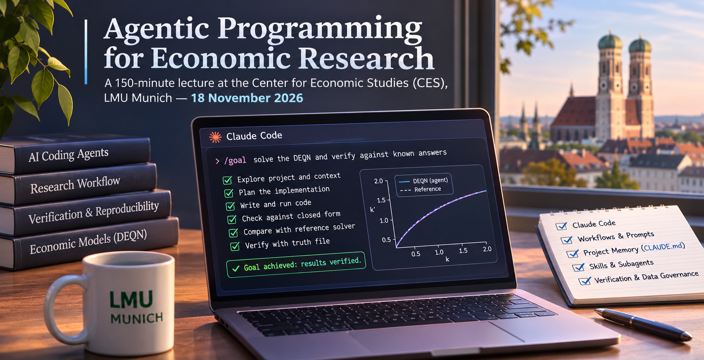

# Agentic Programming for Economic Research



A 150-minute lecture at the Center for Economic Studies (CES), LMU Munich, 18 November 2026:
what AI coding agents such as Claude Code can and cannot be trusted with in economic research.
One example runs through the whole lecture: a neural solver for a growth model, built step by
step with the agent and graded at every step against a known answer.

## Contents

1. [Install](#1-install)
2. [Replay the lecture](#2-replay-the-lecture)
3. [What is in this repository](#3-what-is-in-this-repository)
4. [The lecture at a glance](#4-the-lecture-at-a-glance)
5. [The lead example](#5-the-lead-example)
6. [Readings and licence](#6-readings-and-licence)

## 1. Install

Needs Python 3.10–3.12 and a laptop CPU; to run the agent, a Claude account (paid plan or API key).

```bash
git clone https://github.com/sischei/agentic_programming_munich_1126.git
cd agentic_programming_munich_1126
python3 -m venv .venv
source .venv/bin/activate              # Windows: .venv\Scripts\activate
pip install -r requirements.txt        # numpy, scipy, pandas, matplotlib, torch, pytest
```

Claude Code itself: `curl -fsSL https://claude.ai/install.sh | bash` (macOS: `brew install --cask claude-code`),
then `claude --version` and `claude doctor`. The optional hooks in `code/hooks/settings.json` also use
`jq`, `ruff` and `latexmk`.

## 2. Replay the lecture

```bash
bash code/setup_demo_project.sh        # builds demo/: the project every live session runs in
cd demo && claude                      # then paste the prompts from code/prompts.md
```

[`code/WALKTHROUGH.md`](code/WALKTHROUGH.md) lists every file in lecture order with its slide and command;
[`code/prompts.md`](code/prompts.md) has every prompt, ready to paste. Without an agent, from the repository root:

```bash
python3 code/deqn/deterministic.py                    # Step 1: the port, 4.9e-4 from the closed form (3 s)
python3 code/deqn/solution/deqn_stochastic.py         # Step 4: our solver and its on-path numbers (11 s)
python3 code/deqn/stochastic_box.py                   # the silent failure: lower loss, wrong policy (11 s)
python3 code/deqn/accuracy.py code/deqn/outputs/deqn_stochastic.pt --plot check.pdf   # verdict and figure
```

Cost: a Pro subscription covers every demo; on the API, about a dollar on Sonnet, a few on Opus.

## 3. What is in this repository

| Path | What |
|---|---|
| [`slides/Agentic_Programming_Munich.pdf`](slides/Agentic_Programming_Munich.pdf) | the deck, 75 pages (LaTeX source and figures next to it) |
| [`code/WALKTHROUGH.md`](code/WALKTHROUGH.md), [`code/prompts.md`](code/prompts.md) | every file and every prompt, in lecture order, with slide numbers |
| [`code/deqn/`](code/deqn/README.md) | the lead example: scripts, the five tests, the reference, the committed numbers and figures |
| `code/brock_mirman_reference.py`, `code/data/` | the reference solver (the known answer) and five simulated economies |
| `code/skills/`, `code/agents/`, `code/hooks/`, `code/CLAUDE_md_*.md` | the skills, eight subagents, the settings file with deny rules and hooks, two `CLAUDE.md` files |
| `code/setup_demo_project.sh` | builds `demo/` (git-ignored) from the pieces above |
| `code/extras/`, `code/euler_check_demo.py` | material from earlier versions, not on the slides |

## 4. The lecture at a glance

| Part | Topic | Slides |
|---|---|---|
| Intro | Why now; what "agentic" means; today's plan | 1–4 |
| I | Mental models: tiers, the context window, the workflow; the running example and its seven steps | 5–12 |
| II | Setting up: Claude Code, models and effort, git, the demo project (demo 1) | 13–19 |
| III | The core loop on Step 1; the same task in plan mode (demo 2); notebooks, parallel sessions, context | 20–27 |
| IV | Prompt engineering: the six-component prompt, constraints, templates, failure modes | 28–34 |
| V | Project memory: `CLAUDE.md` | 36–38 |
| VI | Skills, subagents, deny rules and hooks, MCP (demo 3: the accuracy skill, then a verifier subagent) | 39–45 |
| VII | Autonomous loops: `/goal` builds the solver against five tests (demo 4); the verification figure; guardrails | 46–56 |
| VIII | From plan to table and figure: the reconciled plan, the silent failure, four loss kernels (demo 5), the pipeline | 57–62 |
| IX | Verification, disclosure, referees and supervisors, replication packages, data governance | 63–69 |
| Wrap-up | Quick reference, takeaways, conclusion, references | 70–75 |

Block 1 is Parts I–IV, Block 2 Parts V–IX, with a break in between. Five live demos, nothing to install to attend.

## 5. The lead example

The stochastic Brock–Mirman growth model. A deep equilibrium net (DEQN; Azinovic, Gaegauf and
Scheidegger, 2022) learns the savings rate by gradient descent on the Euler residual. Three known
answers grade it: the closed form of the deterministic case (Step 1), a conventional grid-based reference
solver (Steps 2–7), and a truth file with the hidden persistence of five simulated economies, read
once at the end. Every concept of the lecture is introduced on this example; Part VIII shows a run
whose loss converged while the policy was wrong, and the check that caught it. Details and every
number: [`code/deqn/README.md`](code/deqn/README.md).

## 6. Readings and licence

Korinek (2023, *JEL*); Schluntz and Zhang (2024); Goldsmith-Pinkham (2026); Bilionis et al. (2026);
Hans and Bilionis (2026, arXiv:2607.02134); Cherny (2025); Osmani (2026,
[claude.dev blog](https://claude.dev/blog/which-claude-model-should-you-build-with/)); the
[Claude Code documentation](https://code.claude.com/docs). Full list on the last slide.

[Simon Scheidegger](https://sischei.github.io/), HEC Lausanne and LSE Grantham Research Institute.
Licence: [CC0 1.0](LICENCE).
